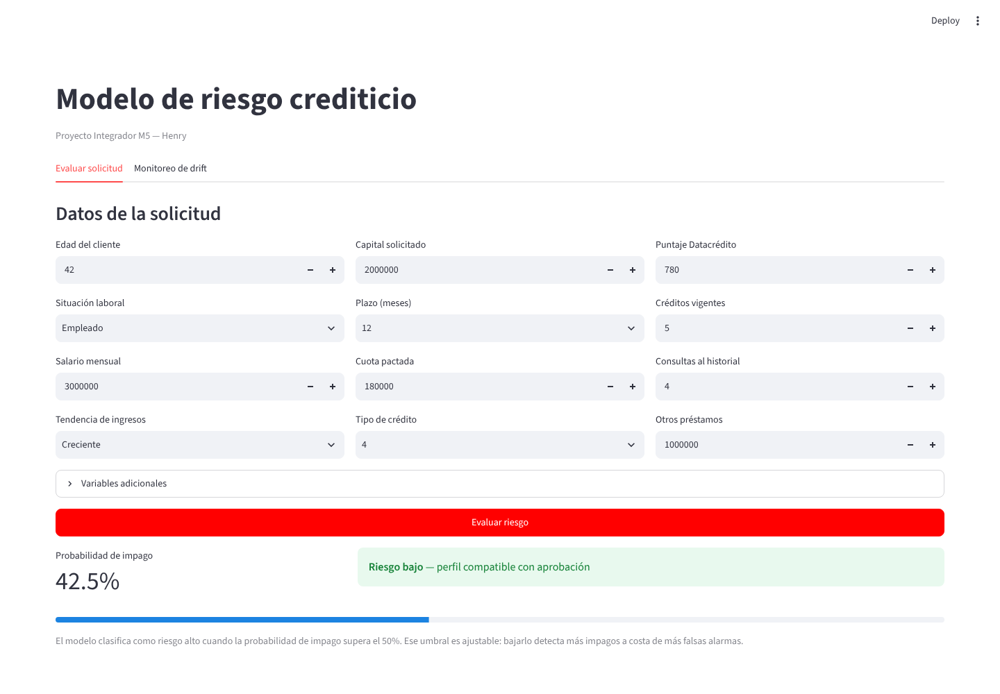
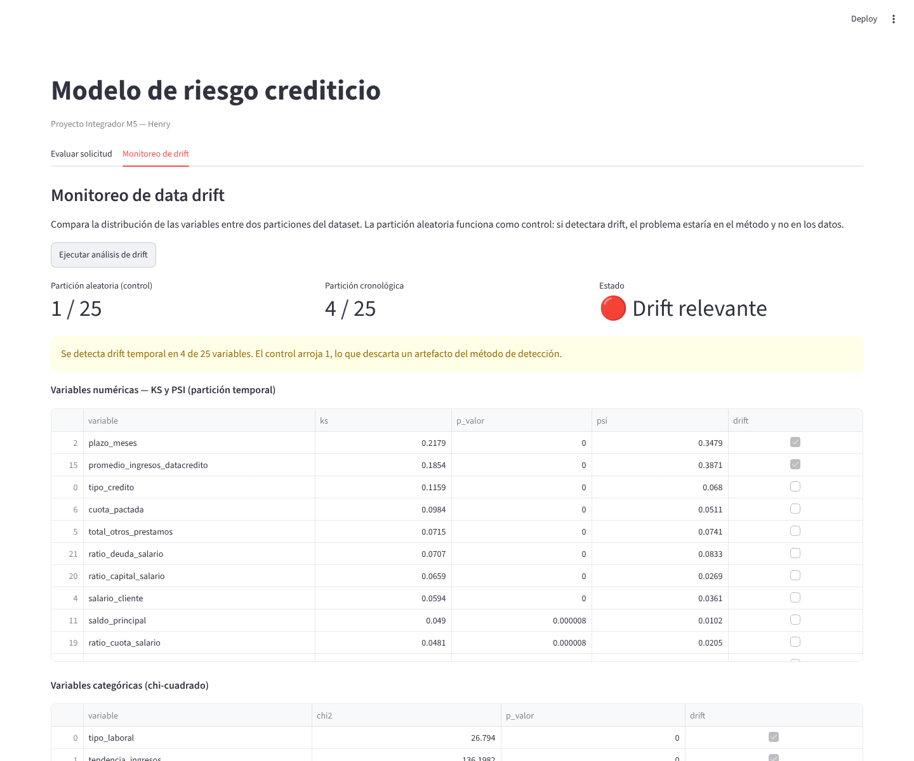

# Modelo de riesgo crediticio

Proyecto Integrador del Módulo 5 (MLOps y Deployment) — Soy Henry.

Modelo de clasificación que estima la probabilidad de que una solicitud de
crédito no sea pagada a tiempo, desplegado como pipeline reproducible.

> **Nota:** este es un ejercicio académico de modelado y MLOps (Proyecto
> Integrador de Soy Henry), no un sistema validado para decisiones crediticias
> reales. El dataset, el desbalance de clases y las métricas resultantes son
> los de este ejercicio puntual — no representan el desempeño que tendría un
> modelo de riesgo crediticio en producción sobre datos de otra financiera.

---

<p align="center"></p>
<p align="center"><sub>Dashboard Streamlit, pestaña "Evaluar solicitud" — captura real de una corrida local del modelo entrenado.</sub></p>

## Resumen ejecutivo

- **El modelo detecta 58 de 102 impagos en el set de prueba (recall 0,569)**,
  a costa de generar muchas falsas alarmas: de cada 13 solicitudes marcadas
  como riesgosas, solo 1 realmente lo era (precision 0,076). Es una elección
  deliberada — en crédito, dejar pasar un impago (capital perdido) cuesta más
  que rechazar por error una solicitud sana — pero significa que, tal como
  está, el modelo no sirve para decidir solo, sino para priorizar qué
  solicitudes revisar con más atención.
- **Se detectaron y eliminaron dos fugas de información** antes de entrenar:
  una variable (`puntaje`) que separaba perfectamente las clases por estar
  calculada con información posterior al resultado, y las variables de mora
  (`saldo_mora`), que no existen al momento de evaluar una solicitud nueva.
  Sin esa limpieza, el modelo hubiera mostrado métricas casi perfectas sin
  capacidad real de generalizar.
- **El pipeline queda reproducible y monitoreado**: API con FastAPI y
  validación de entrada, contenedor Docker, 43 tests automatizados, CI con
  SonarCloud (A en seguridad/confiabilidad/mantenibilidad), y monitoreo de
  drift con dos métricas (KS y PSI) que confirmaron un cambio temporal real
  en 2 de 25 variables.

---

## El problema

Una financiera necesita anticipar qué solicitantes incumplirán el pago de su
crédito. El dataset contiene **10.763 créditos históricos** con 23 variables
cada uno.

La variable objetivo es `Pago_atiempo`: 1 si el crédito se pagó a tiempo, 0 si
no. **El 95,25% pagó** — solo 511 registros corresponden a impago.

Ese desbalance condiciona todo el proyecto: un modelo que prediga "paga" para
todos alcanza 95,25% de accuracy sin detectar un solo cliente riesgoso. Por eso
la evaluación se apoya en precision, recall, F1 y ROC-AUC sobre la clase
minoritaria, y nunca en accuracy.

---

## Hallazgos principales

### Fuga de información en `puntaje`

El 87,4% de los registros comparte el valor `95.227787`. Al cruzarla con la
variable objetivo, la separación resulta perfecta: el máximo de `puntaje` entre
los impagos es **62,67** y el mínimo entre quienes pagaron es **63,81**. Un
umbral en 63 clasifica correctamente el 100% de los registros.

Ninguna variable legítima predice sin error. La separación indica que el valor
deriva del resultado o se calculó con posterioridad. **Se excluyó del modelo**:
mantenerla habría producido métricas cercanas a la perfección sin capacidad
real de generalización.

### Fuga en las variables de mora

`saldo_mora` registra el monto actualmente vencido — información posterior al
incumplimiento, no disponible al evaluar una solicitud nueva. Sus 3 casos de
mora de codeudor son además un subconjunto exacto de los 55 del titular.
**Ambas se excluyeron.**

### El cero como dato faltante

El dataset utiliza 0 para representar ausencia de dato en varias columnas: 24
salarios en cero, 145 puntajes de Datacrédito en cero. Se unificaron como
valores faltantes.

### Los faltantes son informativos

2.930 registros carecen de datos de Datacrédito, y la ausencia no es aleatoria:
afecta al 41% de los independientes frente al 19% de los empleados. Esos
registros presentan **5,73% de impago contra 4,38%** (chi-cuadrado,
p = 0,0038), por lo que se incorporó un indicador binario que preserva la
condición al imputar.

### Ninguna variable separa las clases

Cinco variables muestran diferencia estadísticamente significativa
(Mann-Whitney): `puntaje_datacredito`, `huella_consulta`, `edad_cliente`,
`promedio_ingresos_datacredito` y `capital_prestado`. Pero sus distribuciones
se superponen: el impago no se explica por ninguna variable aislada.

Es el comportamiento esperable tras eliminar las fugas.

---

## Resultados

| Modelo                 | Precision | Recall    | F1        | ROC-AUC   |
| ----------------------- | --------- | --------- | --------- | --------- |
| **LogisticRegression** | 0,076     | **0,569** | 0,134     | **0,691** |
| RandomForest           | 1,000     | 0,039     | 0,076     | 0,661     |
| XGBoost                | 1,000     | 0,029     | 0,057     | 0,656     |
| RandomForest ajustado  | 0,099     | 0,373     | **0,156** | 0,681     |

Métricas sobre la clase 0 (impago), en el conjunto de prueba.

Validación cruzada de 5 particiones: F1 de **0,137 ± 0,007** y ROC-AUC de
**0,668 ± 0,017** para LogisticRegression. Los resultados son estables.

### Modelo seleccionado: LogisticRegression

El RandomForest ajustado alcanza mejor F1, pero detecta **38 impagos frente a
58**. En crédito, el costo de un falso negativo —el capital prestado— supera al
de un falso positivo —la ganancia de un crédito no otorgado—, por lo que se
priorizó recall sobre F1.

Matriz de confusión del modelo elegido:

|                  | Pred: impago | Pred: pago |
| ---------------- | ------------ | ---------- |
| **Real: impago** | 58           | 44         |
| **Real: pago**   | 704          | 1.347      |

### El umbral es ajustable

| Umbral            | Detectados | Escapados | Falsas alarmas |
| ----------------- | ---------- | --------- | --------------- |
| 0,40              | 88         | 14        | 1.180           |
| 0,45              | 74         | 28        | 931             |
| **0,50** (actual) | **58**     | **44**    | **704**         |
| 0,60              | 38         | 64        | 326             |

El máximo F1 se alcanza en 0,60, pero bajar el umbral detecta más impagos. La
elección final depende del costo relativo asignado a cada tipo de error.

---

## Monitoreo de drift

Comparación de distribuciones mediante Kolmogorov-Smirnov (numéricas) y
chi-cuadrado (categóricas), con dos particiones:

| Partición            | Variables con drift |
| -------------------- | -------------------- |
| Aleatoria (control)  | 1 de 25              |
| Cronológica          | 4 de 25              |

El control valida el método: con 25 pruebas, 1 positivo es atribuible al azar.
El contraste confirma que el drift temporal detectado en la partición
cronológica es real.

El criterio de drift para variables **numéricas** marca una variable como
"con drift" si **KS > 0,25 o PSI > 0,25** (alcanza con que una de las dos
supere el umbral, no hace falta que las dos lo hagan), en lugar de basarse
en el p-valor: con 5.381 registros por grupo, el p-valor detecta diferencias
mínimas sin magnitud real —**significativo no equivale a relevante**—,
mientras que KS y PSI miden el tamaño del cambio. Las 4 variables con drift
en la partición cronológica se reparten así:

- **2 numéricas** (criterio KS/PSI, unión no intersección): `plazo_meses`
  (KS 0,218, PSI 0,348) y `promedio_ingresos_datacredito` (KS 0,185, PSI
  0,387). En los dos casos KS queda por debajo de 0,25 y es PSI el que
  dispara el flag — si el criterio exigiera que ambas métricas superen el
  umbral (intersección), ninguna de las dos se habría marcado como drift.
  Usar KS y PSI como unión, no como intersección, es lo que las detecta.
- **2 categóricas** (criterio chi-cuadrado, p-valor): `tipo_laboral` (chi²
  26,79, p < 0,001) y `tendencia_ingresos` (chi² 136,20, p < 0,001).

**Limitación reconocida:** el criterio categórico todavía se apoya en el
p-valor puro, el mismo problema que el criterio numérico evita a propósito
con KS/PSI — con 5.381 registros por grupo, un chi-cuadrado también puede
marcar como "con drift" una diferencia estadísticamente significativa pero
de magnitud chica. Para las categóricas falta una métrica de tamaño de
efecto equivalente a PSI (p. ej. Cramér's V); queda como mejora pendiente
del pipeline de monitoreo.

El dashboard de Streamlit (pestaña "Monitoreo de drift") ejecuta ambos
experimentos bajo demanda y muestra tres cosas: un indicador de nivel de
alerta (🟢 sin drift, 🟡 moderado, 🔴 relevante, según qué proporción de
variables supera el umbral en la partición temporal), la tabla completa con
KS y PSI por variable, y un gráfico que superpone los histogramas de
referencia y actual para la variable que se elija —útil para ver visualmente
la magnitud del cambio en `plazo_meses` o `promedio_ingresos_datacredito`.

<p align="center"></p>
<p align="center"><sub>Dashboard Streamlit, pestaña "Monitoreo de drift" — captura real tras ejecutar el análisis sobre el dataset del repositorio.</sub></p>

Cada corrida de `model_monitoring.py` persiste su resultado en
`reports/drift_report.json` (snapshot completo con el detalle por variable) y
agrega una fila a `reports/drift_history.csv` (fecha, nivel de alerta,
variables con drift), lo que permite auditar la evolución del modelo en
producción sin depender de que el dashboard esté abierto en ese momento.

---

## Estructura

mlops_pipeline/src/
├── Cargar_datos.ipynb ingesta del Excel y exportación a CSV
├── comprension_eda.ipynb exploración, limpieza y EDA
├── ft_engineering.py pipeline de preparación de datos
├── model_training_evaluation.py entrenamiento y selección
├── model_monitoring.py detección de drift
├── model_deploy.py API (avance 4)
└── app_streamlit.py interfaz de usuario


---

## Ejecución

```bash
# Entorno
py -m venv venv
source venv/Scripts/activate
pip install -r requirements.txt

# Pipeline
cd mlops_pipeline/src
python ft_engineering.py              # verifica el preprocesamiento
python model_training_evaluation.py   # entrena y genera modelo_final.pkl
python model_monitoring.py            # análisis de drift

# Interfaz
streamlit run app_streamlit.py
```

`modelo_final.pkl` no se versiona (está en `.gitignore`). Se genera al ejecutar
el entrenamiento, que es requisito previo para la aplicación.

**Instrucciones verificadas desde cero:** los tres pasos de arriba (`pip
install`, `ft_engineering.py`, `model_training_evaluation.py` y
`model_monitoring.py`) se corrieron en un entorno virtual recién creado,
sin nada preinstalado más que `requirements.txt`. Las métricas resultantes
coinciden con las reportadas en este README (recall 0,5686, precision
0,0761, matriz de confusión 58/44/704/1.347; drift en 4 de 25 variables en
la partición cronológica frente a 1 de 25 en la de control).

### API de inferencia

```bash
cd mlops_pipeline/src
uvicorn model_deploy:app --reload
```

Documentación interactiva en <http://localhost:8000/docs>

| Endpoint          | Método | Descripción                                |
| ------------------ | ------ | ------------------------------------------- |
| `/`                | GET    | Información del servicio                   |
| `/health`          | GET    | Verificación de disponibilidad             |
| `/predecir`        | POST   | Evaluación de una solicitud                |
| `/predecir_batch`  | POST   | Evaluación de varias solicitudes a la vez  |

La validación de entrada se realiza con Pydantic sobre las mismas reglas
definidas en el EDA: edad entre 18 y 90, salario superior a 100.000, puntaje
entre 150 y 950. Una solicitud fuera de rango se rechaza con código 422 sin
llegar al modelo.

### Contenedor

```bash
docker build -t credit-risk-api .
docker run -p 8000:8000 credit-risk-api
```

La imagen parte de `python:3.12-slim` e instala las dependencias fijadas en
`requirements.txt`, de modo que el servicio se ejecuta igual en cualquier
máquina con Docker, con independencia de la versión de Python instalada
localmente.

`modelo_final.pkl` debe existir antes de construir la imagen: se genera con
`model_training_evaluation.py`.

### Testing y calidad de código

```bash
pytest                                      # corre la suite completa
pytest --cov=mlops_pipeline/src --cov-report=term-missing
```

43 tests cubren las cuatro piezas del pipeline:

| Archivo probado                  | Qué se verifica |
| --------------------------------- | ---------------- |
| `ft_engineering.py`               | reglas de validación, atributos derivados, que el preprocesador no deje nulos y que `fit`/`transform` respeten train/test |
| `model_deploy.py`                 | los cuatro endpoints, validación de Pydantic, que `/predecir` y `/predecir_batch` den el mismo resultado para la misma solicitud |
| `model_monitoring.py`             | que PSI dé 0 ante distribuciones iguales y detecte un cambio de media real; que las columnas con pocos datos se excluyan sin error |
| `model_training_evaluation.py`    | cálculo de métricas, balanceo de clases según los datos recibidos, comportamiento de `optimizar_umbral` con un modelo simulado |

El análisis de calidad corre automáticamente en cada push mediante GitHub
Actions y SonarCloud: [ver el proyecto en SonarCloud](https://sonarcloud.io/project/overview?id=mmelgarejo-ds_credit-risk-mlops).
El estado general del código (Overall Code) está en A en seguridad,
confiabilidad y mantenibilidad, con 0% de duplicación. El Quality Gate para
"código nuevo" exige 80% de cobertura sobre las líneas modificadas
recientemente, un criterio pensado para proyectos con historial largo de
commits incrementales; en un repositorio entregado de una vez, ese umbral no
se alcanza pese a que la cobertura global del proyecto es de 45%.

---

## Decisiones y limitaciones

**Sin diccionario de datos.** La interpretación de `tipo_credito`,
`huella_consulta` o `puntaje` se apoya en convenciones del dominio crediticio.
Condiciona la traducción de hallazgos a decisiones de negocio, no el modelado.

**`tendencia_ingresos` contiene 58 valores numéricos** donde deberían figurar
las tres categorías. Se agruparon en una categoría `valor_anomalo` en lugar de
recodificarlos por signo: la interpretación de esos valores no es verificable
con los datos disponibles.

**Descenso de volumen sin explicación.** El dataset pasa de 1.917 créditos en
enero de 2025 a 11 en abril de 2026. Se evaluaron dos hipótesis —maduración de
la cartera y corte en la extracción— y ninguna es compatible con los datos. Se
documenta el patrón sin atribuirle causa.

**Los atributos derivados se calculaban originalmente en tres lugares**
(`ft_engineering.py`, `predecir` y `predecir_batch` en `model_deploy.py`),
con riesgo de *feature drift* si alguna copia quedaba desactualizada. Se
centralizó el cálculo de la API en `calcular_derivados()`, usada por ambos
endpoints. `app_streamlit.py` conserva su propia copia para el formulario
interactivo, pendiente de unificar.

**Herramientas aplicadas fuera del temario del módulo:** pruebas de
chi-cuadrado, binomial y Mann-Whitney para validar diferencias observadas, y
transformación logarítmica sobre las variables de monto (reduce el sesgo de
`capital_prestado` de 3,72 a 0,11).
